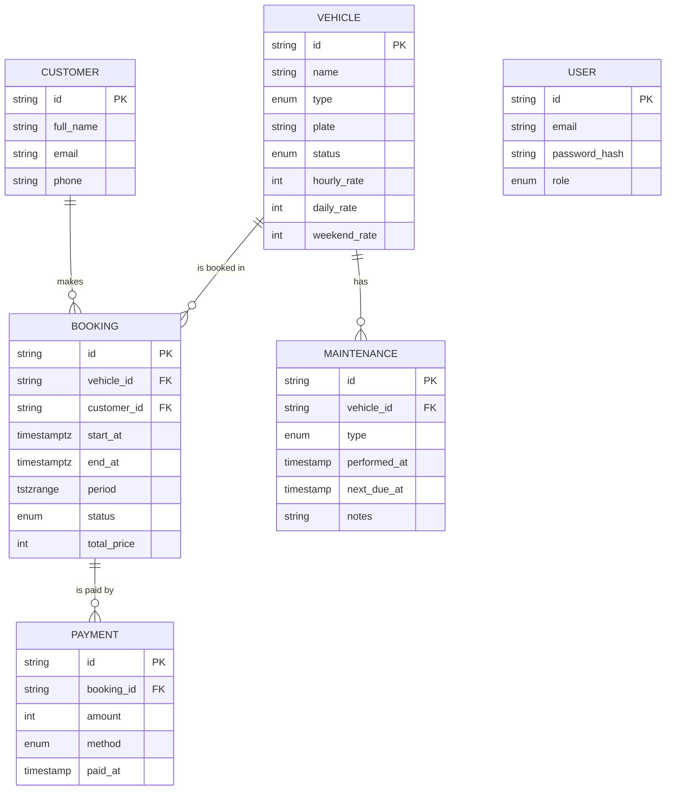

# ATV & Motorcycle Rental

University project (CTI, UGAL). Web platform for an ATV / motorcycle rental business: public booking site plus admin panel.

**Status: step 1 — project skeleton.** Schema, booking logic, one public flow (catalog → booking form → API). Auth and admin CRUD come next.

## Stack

Next.js (App Router) · TypeScript · PostgreSQL + Prisma · Zod · Tailwind CSS · Vitest · Locust · Docker Compose

## Run

```
cp .env.example .env
npm install
docker compose up -d db
npx prisma migrate dev --name init
npx prisma migrate dev --create-only --name booking_no_overlap
#   paste prisma/sql/booking_no_overlap.sql into the generated migration.sql, then:
npx prisma migrate dev
npx prisma db seed
npm test
npm run dev
```

Everything in Docker: `docker compose up --build` (the `app` service runs `prisma migrate deploy` on start).

Load test (pick a vehicle id from the DB):

```
VEHICLE_ID=<id> locust -f loadtests/locustfile.py --host http://localhost:3000
```

## Key design decision: overlap prevention in the database

Prisma cannot express exclusion constraints, so `prisma/sql/booking_no_overlap.sql` is a manual migration:

- `bookings.period` is a generated `tstzrange(start_at, end_at, '[)')` column
- `EXCLUDE USING gist (vehicle_id WITH =, period WITH &&) WHERE (status <> 'CANCELLED')` (needs `btree_gist`)

The API does not pre-check availability; it inserts and maps the constraint violation to HTTP 409. Concurrent requests for the same slot therefore cannot both succeed.

## ER diagram



## Roadmap

1. ~~Schema~~ · 2. Auth.js + admin CRUD · 3. Bookings calendar + availability · 4. Public pages polish · 5. Payments + maintenance · 6. Reports + more tests · 7. Docs (UML)

Future work (out of MVP): online payments, Redis/BullMQ, Nginx/HTTPS, Playwright, CI, emails, PDF contracts, equipment, damages, audit log.
