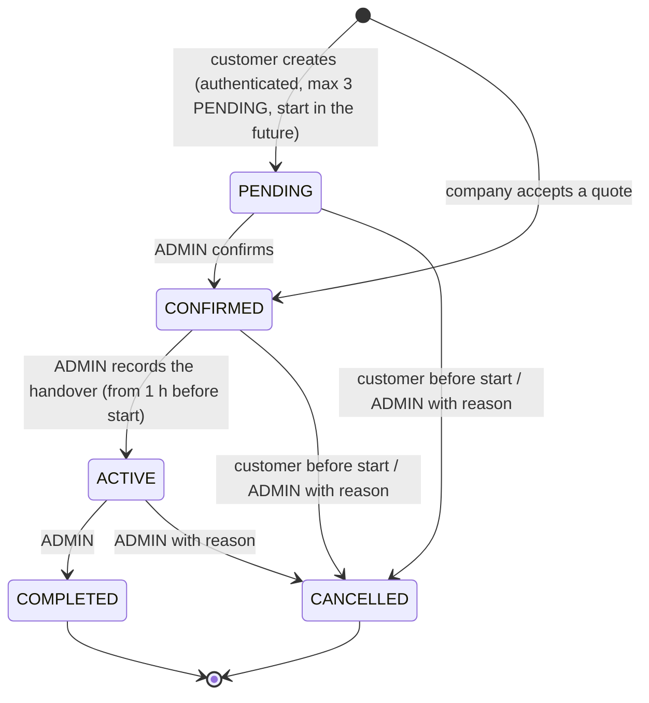
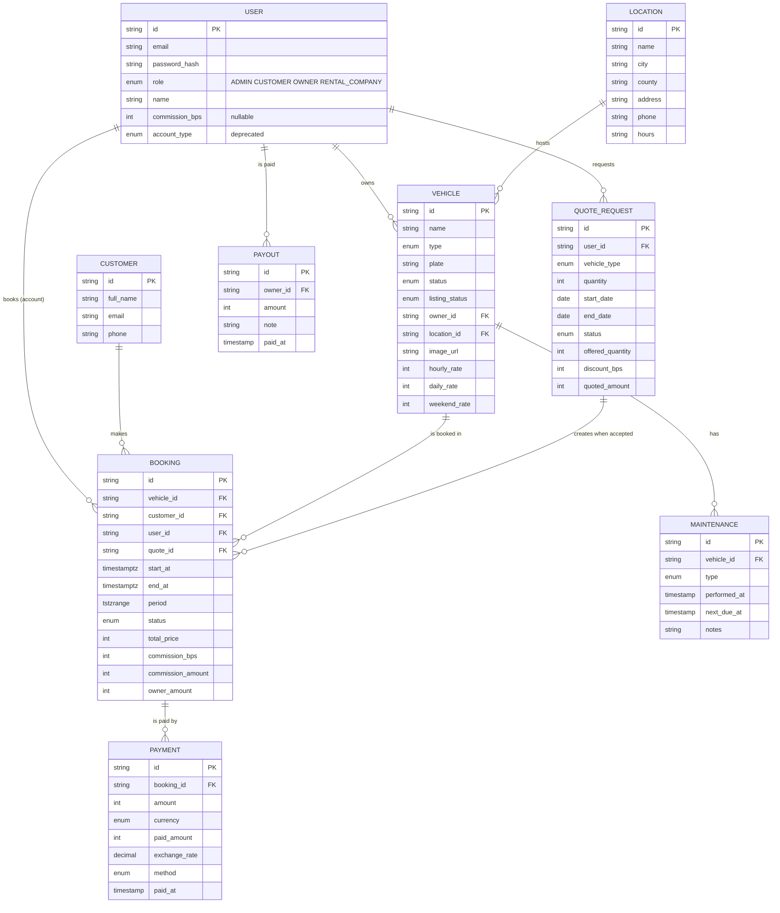

# ATV & Motorcycle Rental

University project (CTI, UGAL). Web platform for an ATV / motorcycle rental business: public booking site plus admin panel.

**Status: step 1 — project skeleton.** Schema, booking logic, one public flow (catalog → booking form → API). Auth and admin CRUD come next.

## Stack

Next.js (App Router) · TypeScript · PostgreSQL + Prisma · Zod · Tailwind CSS · Vitest · Locust · Docker Compose

## Run

```
cp .env.example .env   # then set AUTH_SECRET (openssl rand -base64 32) and the admin password
npm install
docker compose up -d db
npx prisma migrate deploy   # all migrations are in prisma/migrations, including booking_no_overlap
npx prisma db seed
npm test
npm run dev
```

### Ports

| Service | Host port | Notes |
|---|---|---|
| PostgreSQL (Docker `db`) | **5433** | Mapped to 5432 inside the container. Host port 5432 is left free for a local PostgreSQL installation, which is never touched. `DATABASE_URL` in `.env` uses `localhost:5433`. |
| App (`npm run dev`) | 3000, or the next free port | Next.js prints the port it picked. |
| App (Docker `app`) | 3000 | Talks to the database as `db:5432` on the Compose network. |

The seed creates **fictional demo data** only: locations use placeholder addresses and the phone number `+40 000 000 000`.

Everything in Docker: `docker compose up --build` (the `app` service runs `prisma migrate deploy` on start).

Load test (pick a vehicle id from the DB):

```
VEHICLE_ID=<id> locust -f loadtests/locustfile.py --host http://localhost:3000
```

## Key design decision: overlap prevention in the database

Prisma cannot express exclusion constraints, so `prisma/sql/booking_no_overlap.sql` is a manual migration:

- `bookings.period` is a generated `tstzrange(start_at, end_at, '[)')` column
- `EXCLUDE USING gist (vehicle_id WITH =, period WITH &&) WHERE (status <> 'CANCELLED')` (needs `btree_gist`)

The API does not pre-check availability; it inserts and maps the constraint violation to HTTP 409. Concurrent requests for the same slot therefore cannot both succeed.

## Roles

Four roles form a hierarchy: `CUSTOMER` < `OWNER` < `RENTAL_COMPANY` < `ADMIN`.

| Capability | CUSTOMER | OWNER | RENTAL_COMPANY | ADMIN |
|---|---|---|---|---|
| Rent vehicles, see own bookings | yes | yes | yes | no |
| List own vehicles (admin approves each listing) | no | yes | yes | no |
| Bulk quotes for many vehicles | no | no | yes | no |
| Approve listings, manage bookings, payouts, locations, users | no | no | no | yes |

- The role is chosen at registration (ADMIN can never be self-assigned) and changed afterwards **only by an ADMIN** in `/admin/users`.
- The session token carries only the user id. **The role is read from the database on every request**, so a demotion applies immediately and role claims inside an old or forged token are ignored.
- Role changes are refused for: changing your own role; demoting the last ADMIN; demoting a user who still owns vehicles that are not `RETIRED`; demoting a `RENTAL_COMPANY` that still has quotes in `QUOTED` state. An outstanding balance owed to a demoted owner only produces a warning. Existing bookings are never cancelled automatically.
- The change runs in one transaction that locks the target and all ADMIN rows (`SELECT ... FOR UPDATE`, in id order), so concurrent changes cannot leave zero admins. Creating a listing locks the owner's row and re-checks the role in the same way.
- `users.account_type` is **deprecated**: kept in the database for compatibility, no longer used by the code.

## Booking lifecycle



- Every transition is an explicit action: **nothing changes status because of the time alone.** Time only decides whether an action is allowed.
- **Customers** (CUSTOMER, OWNER, RENTAL_COMPANY) can only cancel their own booking, and only before `startAt`. After the start, only an ADMIN can cancel, always with a reason. Other people's bookings do not exist for them (404).
- **Handover** is recorded manually by an ADMIN, from 1 hour before `startAt` until `endAt`. More than 1 hour after the start the booking shows the derived indicator `HANDOVER_DELAYED` and the handover needs a reason. The handover fails (no partial change) if the vehicle is in service, retired or not approved, or if another booking of the same vehicle is still ACTIVE.
- **Completing** is allowed even with an unpaid balance: the admin gets a warning with the amount; nothing is marked as paid automatically.
- `RENTED` is never stored: a vehicle is shown as rented while one of its bookings is ACTIVE.
- Every status change writes a row in `booking_status_history` (from, to, actor, note, time) **in the same transaction**; a refused or failed change leaves no row. Rows whose note starts with `backfill:` were generated by the migration for bookings that existed earlier and carry no real actor or original time.
- Transitions use a conditional update (`WHERE status = <expected>`) inside a transaction that first locks the vehicle row, and the partial unique index `bookings_one_active_per_vehicle` guarantees at most one ACTIVE booking per vehicle even if application code were bypassed.
- Creating a booking: authentication is required; the email sent must be the email of the account (otherwise `400 email_mismatch`); an owner cannot book their own vehicle; ADMIN accounts do not book. The user's row is locked (`SELECT ... FOR UPDATE`) before counting PENDING bookings, so the limit of 3 holds under concurrency. The vehicle's row is locked too, so simultaneous bookings of one vehicle end as clean `409 conflict` answers and never as PostgreSQL deadlocks. Lock order everywhere: users first, then vehicles. Transient errors (deadlock victim, serialization failure) are retried automatically.

HTTP: `POST /api/bookings` (201, 400, 401, 403, 404, 409, 429 `pending_limit`) and `POST /api/bookings/:id/status` with `{ "to": "CANCELLED", "reason": "..." }`.

## Commission and money

- Money is stored as **integers in RON bani** (exact, never floating point) and rates as **integers in basis points** (100 bps = 1%). Rounding is half up, in whole bani, in pure integer arithmetic (`src/lib/commission.ts`).
- Rates: vehicles of the platform's own fleet (no owner) **0%**; individual OWNER a fixed **15%**; RENTAL_COMPANY a rate set by an ADMIN per company, **at least 5%** (15% until set). The rate stored on an OWNER account is ignored.
- The commission is computed on the amount actually charged for the booking (after any discount, before deposits or extra fees; no deposit or penalty is modelled, so none is charged commission).
- **The snapshot** (rate, commission amount, owner share) is stored on the booking **when it is created**, so later rate changes never alter existing bookings. What is owed to an owner accrues only for COMPLETED bookings; it is kept separate from the payouts that an ADMIN records manually. Payments from customers and payouts to owners are recorded by hand: there are no online payments.
- An owner or company sees only its own figures.

## Bulk offers for rental companies

Only `RENTAL_COMPANY` accounts request them (`/quotes`). A request names the vehicle type, quantity, calendar days, optional location and purpose.

- The system builds the offer from what is really free, in this order: the platform's own fleet first, then owners with the fewest bookings so far. It never offers the company's own vehicles, vehicles in service or retired, unapproved listings, or vehicles that are busy during the period. It may offer **fewer** vehicles than requested, and then says so.
- The offer stores the **exact vehicles and prices** (`quote_items`: list price and price after the bulk discount, 5% from 5 vehicles and 10% from 10) and a `revision` number (version). The company sees the list and the total before accepting.
- An offer is **not a reservation**: nothing is held. Accepting must send the `revision` the company saw. In one transaction the system locks the vehicles, checks that **every** listed vehicle is still bookable and free, and creates one CONFIRMED booking per item at exactly the listed price (with commission snapshot and history). All or nothing.
- If the revision is old: nothing happens and the company is told to review the current version. If a vehicle is no longer available: **nothing is confirmed, not even partly**; the offer is recalculated, the `revision` increases and the new list must be accepted again explicitly. If no vehicle is left, nothing is booked and the offer is closed with an explanation. Offers created before `quote_items` existed have no list and are recalculated before they can be accepted.
- Offers do not expire automatically. Accepted prices are honoured even if an owner changes the rates later.
- Quotes count whole calendar days in Bucharest time (see below).

## Time zone and date rules

Every instant is stored in the database as an absolute UTC timestamp (`timestamptz`). Business calendar rules use **Europe/Bucharest**, and all conversions go through `src/lib/business-time.ts` (built on `Intl`, no extra dependency, never the machine's own time zone).

- **Booking form:** the `datetime-local` values are read as Bucharest time, whatever time zone the browser uses. A time that does not exist (clocks jump forward, e.g. 03:30 on 28 March 2027) is rejected with a message. A time that exists twice (clocks go back, e.g. 03:30 on 25 October 2026) resolves to its **first** occurrence. `POST /api/bookings` still takes ISO instants, so the API contract did not change.
- **Display:** booking times are shown in Bucharest time.
- **Weekend rate:** a rental gets the flat weekend rate only if it lasts more than 24 hours and fits between Saturday 00:00 and Monday 00:00 **Bucharest time** (that window is 47 or 49 hours long on the weekends when the clocks change).
- **No bookings in the past:** `POST /api/bookings` answers `400 {"error":"start_in_past"}` unless `startAt` is strictly after the current instant. The same rule applies to the bookings created when a company accepts a quote, and a quote request's first day must be after today (Bucharest date).
- **Quotes** count whole calendar days in Bucharest time: N calendar days cost N daily rates (or the flat weekend rate when cheaper), even when one of the days has 23 or 25 hours because of a clock change. The vehicles are searched over the period from local midnight of the first day to local midnight after the last day. Normal bookings are still billed per started block of 24 physical hours.

## Tests

- `npm test`: fast unit tests, no database needed.
- `npm run test:tz`: the same unit tests repeated under six different machine time zones (UTC, Bucharest, Los Angeles, Auckland, Kolkata, Lord Howe), to prove the date rules do not depend on the machine.
- `npm run test:integration`: tests that use a real PostgreSQL. They run **only** against `TEST_DATABASE_URL`. The launcher validates the target before creating, migrating or deleting anything, and refuses to run if the variable is missing, if the host is not local, if the database name does not end with `_test`, or if it is the same database as `DATABASE_URL`. The test process validates it again. The test database (default `rental_test`) is created automatically; the development database is never touched.

## ER diagram



## Roadmap

1. ~~Schema~~ · 2. Auth.js + admin CRUD · 3. Bookings calendar + availability · 4. Public pages polish · 5. Payments + maintenance · 6. Reports + more tests · 7. Docs (UML)

Future work (out of MVP): online payments, Redis/BullMQ, Nginx/HTTPS, Playwright, CI, emails, PDF contracts, equipment, damages, audit log.
