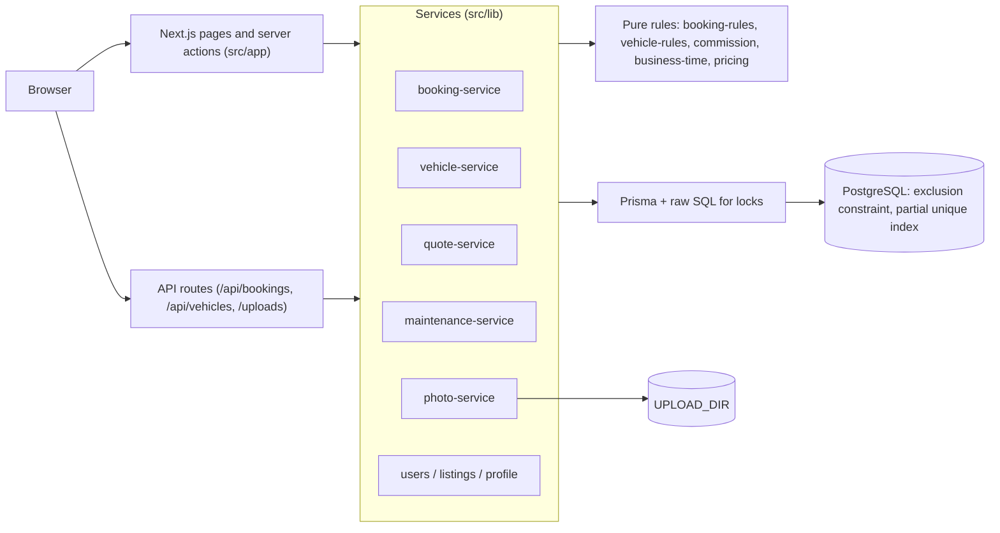
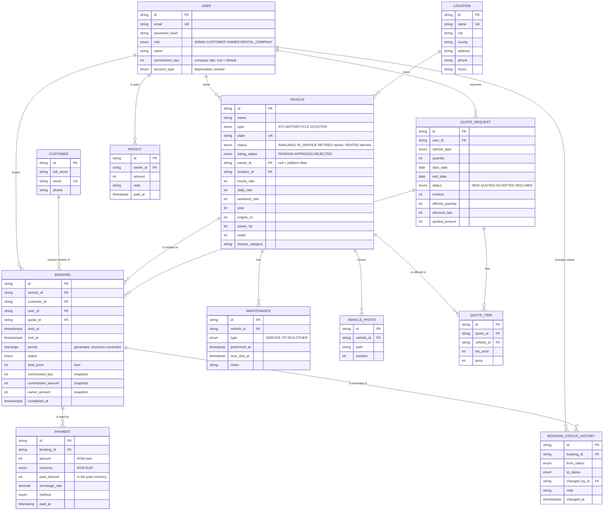
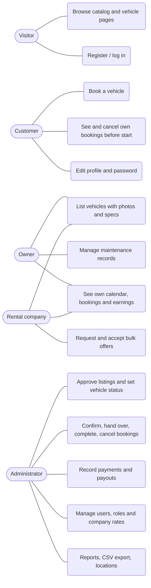
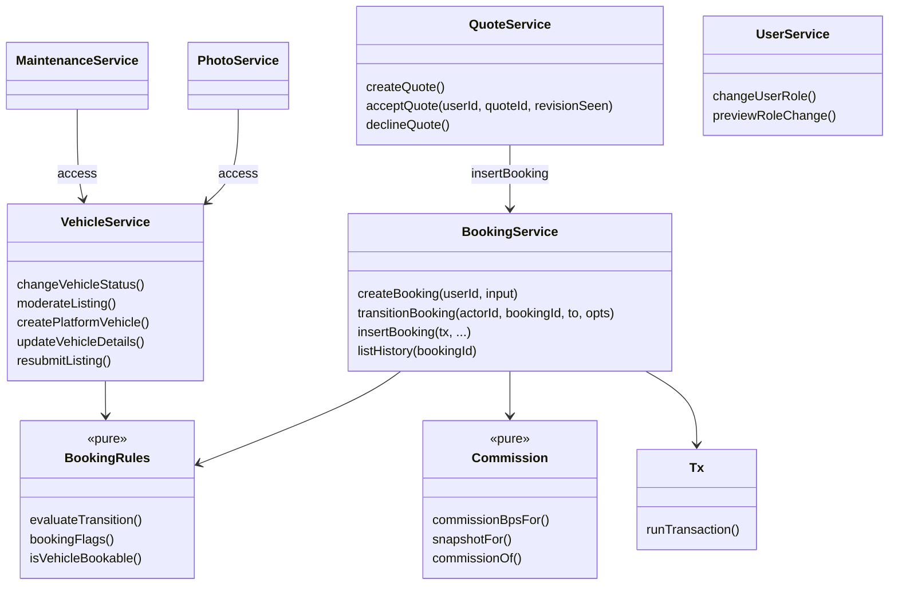
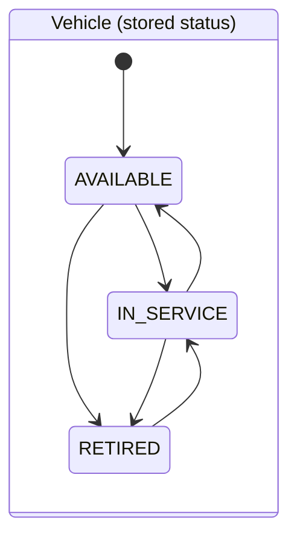
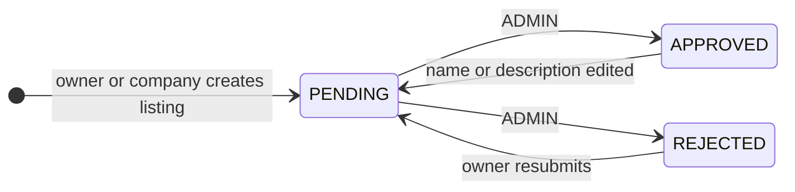
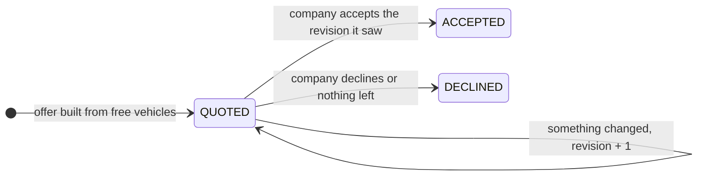

# Architecture, ER and UML

## Layers



Business logic lives in the services and the pure rule modules; pages and routes only authenticate, parse input (Zod) and call a service. The database is the last line of defence: the overlap constraint and the "one ACTIVE booking per vehicle" index hold even if application code were bypassed.

## ER diagram



Money columns are integers in bani (1/100 RON), rates are basis points; only the exchange rate stored with an EUR payment is a decimal.

## Use cases



CUSTOMER < OWNER < RENTAL_COMPANY: an owner or company can also do everything a customer does. ADMIN does not rent.

## Class view of the services



## Sequence: creating a booking

```mermaid
sequenceDiagram
  actor U as Customer
  participant P as BookingPanel (browser)
  participant A as POST /api/bookings
  participant S as booking-service
  participant D as PostgreSQL
  U->>P: pick start and end (Bucharest time)
  P->>A: GET /api/vehicles/:id/price (estimate, availability)
  U->>P: Request booking
  P->>A: POST {vehicleId, startAt, endAt, customer}
  A->>A: session, Zod validation
  A->>S: createBooking(userId, input)
  S->>D: BEGIN; SELECT user FOR UPDATE
  S->>D: count PENDING (max 3)
  S->>D: SELECT vehicle FOR UPDATE
  S->>S: check bookable, start in future, email = account email
  S->>D: INSERT booking (commission snapshot) + history row
  D-->>S: ok or exclusion violation
  S->>D: COMMIT
  S-->>A: booking or failure code
  A-->>P: 201 / 400 / 401 / 403 / 404 / 409 / 429
```

## Sequence: accepting a bulk offer

```mermaid
sequenceDiagram
  actor C as Rental company
  participant S as quote-service
  participant D as PostgreSQL
  C->>S: acceptQuote(userId, quoteId, revisionSeen)
  S->>D: BEGIN; lock user, quote, vehicles (sorted)
  alt revision differs
    S-->>C: STALE_REVISION, nothing changes
  else every listed vehicle still free
    S->>D: INSERT one CONFIRMED booking per item + history
    S->>D: quote ACCEPTED; COMMIT
    S-->>C: accepted
  else something changed
    S->>D: recalculate items, revision + 1; COMMIT
    S-->>C: OFFER_CHANGED, nothing booked, accept the new version
  end
```

## State diagrams

Booking lifecycle: see [business-rules.md](business-rules.md#booking-lifecycle).






