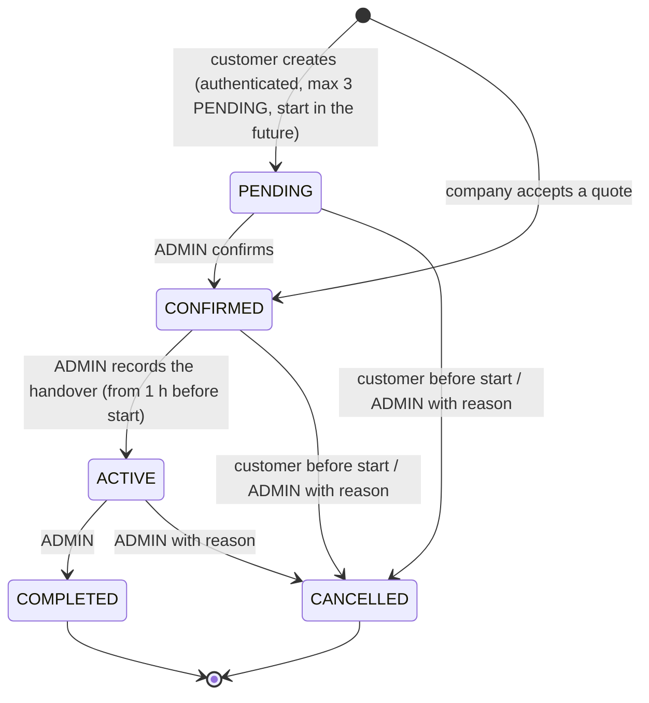

# Business rules

The rules the system enforces. Where a rule is checked is noted in the code; the tests named in the README cover them.

## Roles

Four roles form a hierarchy: `CUSTOMER` < `OWNER` < `RENTAL_COMPANY` < `ADMIN`.

| Capability | CUSTOMER | OWNER | RENTAL_COMPANY | ADMIN |
|---|---|---|---|---|
| Rent vehicles, see own bookings | yes | yes | yes | no |
| List own vehicles (admin approves each listing) | no | yes | yes | no |
| Bulk quotes for many vehicles | no | no | yes | no |
| Approve listings, manage bookings, payouts, locations, users | no | no | no | yes |

- The role is chosen at registration (ADMIN can never be self-assigned) and changed afterwards **only by an ADMIN** in `/admin/users`.
- The session token carries only the user id. **The role is read from the database on every request**, so a demotion applies immediately and role claims inside an old or forged token are ignored.
- Role changes are refused for: changing your own role; demoting the last ADMIN; demoting a user who still owns vehicles that are not `RETIRED`; demoting a `RENTAL_COMPANY` that still has quotes in `QUOTED` state. An outstanding balance owed to a demoted owner only produces a warning. Existing bookings are never cancelled automatically.
- The change runs in one transaction that locks the target and all ADMIN rows (`SELECT ... FOR UPDATE`, in id order), so concurrent changes cannot leave zero admins. Creating a listing locks the owner's row and re-checks the role in the same way.
- `users.account_type` is **deprecated**: kept in the database for compatibility, no longer used by the code.

## Authorization and privacy

- **Passwords** are stored as scrypt hashes (`scrypt$N$r$p$salt$hash`, N=2^15, r=8, p=3) computed on the thread pool of `node:crypto`; older bcrypt hashes still work and are replaced at the next successful login. An unknown e-mail takes as long to refuse as a wrong password. Details and measurements: [performance.md](performance.md).
- Every page, server action and API route checks the session **and** the role read from the database; ownership of the resource is checked in the service as well, so a forged form or request fails even if the page was never shown. Other people's resources answer 404.
- OWNER and RENTAL_COMPANY see only their own vehicles, bookings, earnings and payouts; CUSTOMER only their own bookings; ADMIN sees everything and does not rent.
- Money is shown in RON or EUR (a cookie-based switch; the EUR rate is `EUR_RON_RATE`, and a payment made in EUR stores the rate used).
- Basic hardening headers are sent on every response (`nosniff`, `X-Frame-Options: DENY`, referrer and permissions policies); `X-Powered-By` is off. There is no Content-Security-Policy because Next.js needs inline scripts.
- A NUL character in a URL is answered 400 by a middleware, and every Zod text field refuses it (PostgreSQL cannot store it). Registration can only create CUSTOMER, OWNER or RENTAL_COMPANY accounts; ADMIN is created by the seed and by another administrator.
- CSV cells that start with `=`, `+`, `-`, `@` are neutralized so a spreadsheet does not run them as formulas.
- The Docker image refuses to start with the `change-me` placeholders from `.env.example` or an `AUTH_SECRET` shorter than 16 characters.

## Vehicles, listings and maintenance

- **Listing approval.** Vehicles of the platform's own fleet are approved when an ADMIN creates them. Owners and companies create listings that start `PENDING`; only an ADMIN approves or rejects. Only `APPROVED` vehicles appear in the public catalog. A rejected listing can be corrected and sent for approval again by its owner.
- **Editing.** Price and specification changes keep an approved listing approved and only affect new bookings. Changing the **name or the description** of an approved listing sends it back to `PENDING`.
- **Category.** An optional label inside the type (`Cruiser`, `Adventure & touring`, `Naked & sport`, `Dual-sport & enduro` for motorcycles; `Sport ATV`, `Utility ATV` for ATVs; scooters have none). It must fit the vehicle type (checked in the forms and again in the services) and is only used to browse: the catalog filters, chips and search box ("cruiser" finds the category) and the card badge. It never changes booking, authorization or commission rules.
- **Stored status** is `AVAILABLE`, `IN_SERVICE` or `RETIRED`. `RENTED` is **derived**: a vehicle is shown as rented while one of its bookings is `ACTIVE`. The enum value `RENTED` still exists but is never stored.
- **Status changes** are made only by an ADMIN: `AVAILABLE <-> IN_SERVICE`, `AVAILABLE/IN_SERVICE -> RETIRED`, and `RETIRED -> IN_SERVICE -> AVAILABLE` (a retired vehicle is never made available directly). A vehicle that is out with a customer (an `ACTIVE` booking) cannot be put in service or retired. Upcoming bookings of a vehicle that leaves service are **reported to the admin, never cancelled automatically**, and an in-service or retired vehicle can be neither booked nor handed over.
- **Maintenance** records (`SERVICE`, `ITP`, `RCA`, `OTHER`) have the date done and an optional next deadline (must not be before the date done). The dashboards flag vehicles whose ITP, RCA or service is overdue, due soon or missing. Records are informational: they never change a booking or a status by themselves. Owners manage records of their own vehicles; admins of all.
- **Photos.** Up to 8 per vehicle, JPEG, PNG or WebP, 5 MB each, checked by their real content (magic bytes), not by the file name. They are stored under random names in `UPLOAD_DIR` and served by `/uploads/...` with `nosniff` and long cache headers; path tricks return 404. The first photo is the cover.

## Booking lifecycle

- Every transition is an explicit action: **nothing changes status because of the time alone.** Time only decides whether an action is allowed.
- **Customers** (CUSTOMER, OWNER, RENTAL_COMPANY) can only cancel their own booking, and only before `startAt`. After the start, only an ADMIN can cancel, always with a reason. Other people's bookings do not exist for them (404).
- **Handover** is recorded manually by an ADMIN, from 1 hour before `startAt` until `endAt`. More than 1 hour after the start the booking shows the derived indicator `HANDOVER_DELAYED` and the handover needs a reason. The handover fails (no partial change) if the vehicle is in service, retired or not approved, or if another booking of the same vehicle is still ACTIVE.
- **Completing** is allowed even with an unpaid balance: the admin gets a warning with the amount; nothing is marked as paid automatically.
- `RENTED` is never stored: a vehicle is shown as rented while one of its bookings is ACTIVE.
- Every status change writes a row in `booking_status_history` (from, to, actor, note, time) **in the same transaction**; a refused or failed change leaves no row. Rows whose note starts with `backfill:` were generated by the migration for bookings that existed earlier and carry no real actor or original time.
- Transitions use a conditional update (`WHERE status = <expected>`) inside a transaction that first locks the vehicle row, and the partial unique index `bookings_one_active_per_vehicle` guarantees at most one ACTIVE booking per vehicle even if application code were bypassed.
- Creating a booking: authentication is required; the email sent must be the email of the account (otherwise `400 email_mismatch`); an owner cannot book their own vehicle; ADMIN accounts do not book. The user's row is locked (`SELECT ... FOR UPDATE`) before counting PENDING bookings, so the limit of 3 holds under concurrency. The vehicle's row is locked too, so simultaneous bookings of one vehicle end as clean `409 conflict` answers and never as PostgreSQL deadlocks. Lock order everywhere: users first, then vehicles. Transient errors (deadlock victim, serialization failure) are retried automatically.

HTTP: `POST /api/bookings` (201, 400, 401, 403, 404, 409, 429 `pending_limit`) and `POST /api/bookings/:id/status` with `{ "to": "CANCELLED", "reason": "..." }`.

## Commission and money

- Money is stored as **integers in RON bani** (exact, never floating point) and rates as **integers in basis points** (100 bps = 1%). Rounding is half up, in whole bani, in pure integer arithmetic (`src/lib/commission.ts`).
- Rates: vehicles of the platform's own fleet (no owner) **0%**; individual OWNER a fixed **15%**; RENTAL_COMPANY a rate set by an ADMIN per company, **at least 5%** (15% until set). The rate stored on an OWNER account is ignored.
- The commission is computed on the amount actually charged for the booking (after any discount, before deposits or extra fees; no deposit or penalty is modelled, so none is charged commission).
- **The snapshot** (rate, commission amount, owner share) is stored on the booking **when it is created**, so later rate changes never alter existing bookings. What is owed to an owner accrues only for COMPLETED bookings; it is kept separate from the payouts that an ADMIN records manually. Payments from customers and payouts to owners are recorded by hand: there are no online payments.
- An owner or company sees only its own figures.

## Bulk offers for rental companies

Only `RENTAL_COMPANY` accounts request them (`/quotes`). A request names the vehicle type, quantity, calendar days, optional location and purpose.

- The system builds the offer from what is really free, in this order: the platform's own fleet first, then owners with the fewest bookings so far. It never offers the company's own vehicles, vehicles in service or retired, unapproved listings, or vehicles that are busy during the period. It may offer **fewer** vehicles than requested, and then says so.
- The offer stores the **exact vehicles and prices** (`quote_items`: list price and price after the bulk discount, 5% from 5 vehicles and 10% from 10) and a `revision` number (version). The company sees the list and the total before accepting.
- An offer is **not a reservation**: nothing is held. Accepting must send the `revision` the company saw. In one transaction the system locks the vehicles, checks that **every** listed vehicle is still bookable and free, and creates one CONFIRMED booking per item at exactly the listed price (with commission snapshot and history). All or nothing.
- If the revision is old: nothing happens and the company is told to review the current version. If a vehicle is no longer available: **nothing is confirmed, not even partly**; the offer is recalculated, the `revision` increases and the new list must be accepted again explicitly. If no vehicle is left, nothing is booked and the offer is closed with an explanation. Offers created before `quote_items` existed have no list and are recalculated before they can be accepted.
- Offers do not expire automatically. Accepted prices are honoured even if an owner changes the rates later.
- Quotes count whole calendar days in Bucharest time (see below).

## RideDNA recommendations

Recommendations never change the rules above: they only read approved vehicles that are not in service or retired, use the pricing function of the booking, the same overlap rule as the price preview, and hand
the user to the normal booking, which repeats every check. Licence, power for the experience, seats, budget, category fit and (with a chosen day) availability are hard exclusions; a score only orders the vehicles that remain. A vehicle
with missing data is not treated as a match. Details: [ridedna.md](ridedna.md).

## Time zone and date rules

Every instant is stored in the database as an absolute UTC timestamp (`timestamptz`). Business calendar rules use **Europe/Bucharest**, and all conversions go through `src/lib/business-time.ts` (built on `Intl`, no extra dependency, never the machine's own time zone).

- **Booking form:** the `datetime-local` values are read as Bucharest time, whatever time zone the browser uses. A time that does not exist (clocks jump forward, e.g. 03:30 on 28 March 2027) is rejected with a message. A time that exists twice (clocks go back, e.g. 03:30 on 25 October 2026) resolves to its **first** occurrence. `POST /api/bookings` still takes ISO instants, so the API contract did not change.
- **Display:** booking times are shown in Bucharest time.
- **Weekend rate:** a rental gets the flat weekend rate only if it lasts more than 24 hours and fits between Saturday 00:00 and Monday 00:00 **Bucharest time** (that window is 47 or 49 hours long on the weekends when the clocks change).
- **No bookings in the past:** `POST /api/bookings` answers `400 {"error":"start_in_past"}` unless `startAt` is strictly after the current instant. The same rule applies to the bookings created when a company accepts a quote, and a quote request's first day must be after today (Bucharest date).
- **Quotes** count whole calendar days in Bucharest time: N calendar days cost N daily rates (or the flat weekend rate when cheaper), even when one of the days has 23 or 25 hours because of a clock change. The vehicles are searched over the period from local midnight of the first day to local midnight after the last day. Normal bookings are still billed per started block of 24 physical hours.

## Overlap prevention in the database

Prisma cannot express exclusion constraints, so `prisma/sql/booking_no_overlap.sql` is a manual migration:

- `bookings.period` is a generated `tstzrange(start_at, end_at, '[)')` column
- `EXCLUDE USING gist (vehicle_id WITH =, period WITH &&) WHERE (status <> 'CANCELLED')` (needs `btree_gist`)

The API does not pre-check availability; it inserts and maps the constraint violation to HTTP 409. Concurrent requests for the same slot therefore cannot both succeed.

